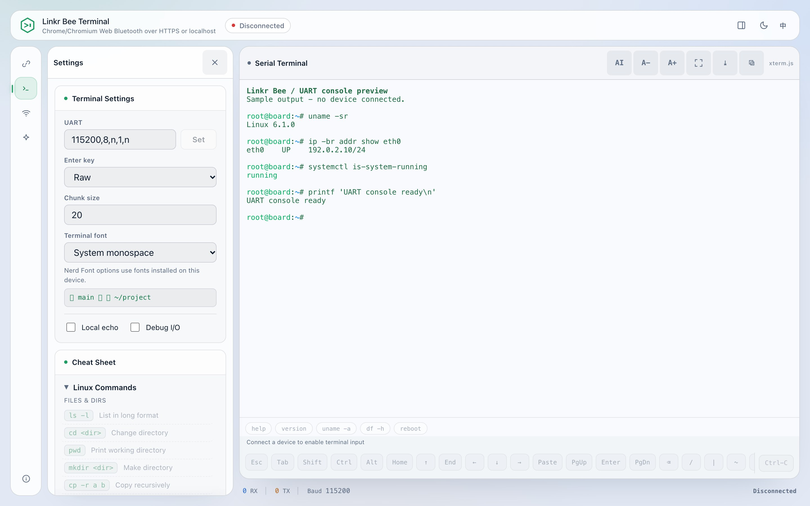
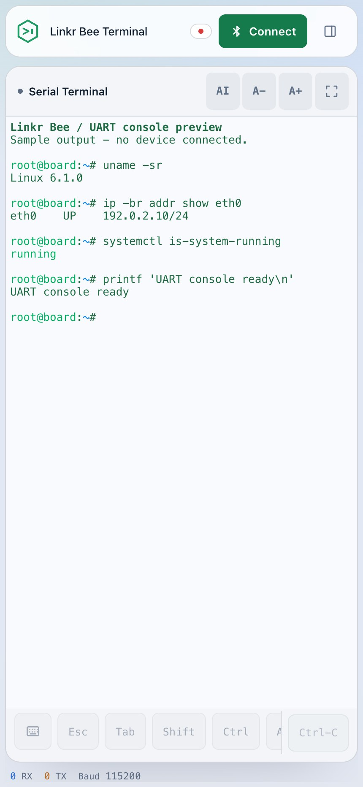

# Linkr Bee user guide

[Project overview](../README.md) | [Documentation](README.md) | [中文使用指南](USAGE.zh-CN.md)

This guide covers the shared Web, Android/iOS, and HarmonyOS terminal interface.
For desktop CLI/TUI commands, use the [Rust host terminal guide](../tools/linkr-tui/README.md).
Build, signing, and integration instructions belong to the [development guide](DEVELOPMENT.md)
and the individual platform guides.

## First connection

1. Flash the firmware for your accessory and connect the target's 3.3 V UART:
   target TX to Bee RX, target RX to Bee TX, and common ground. On the C3 Super Mini,
   Bee RX is GPIO20 and Bee TX is GPIO21.
2. Open the client. For the Web terminal, run `tools/serve_web.sh` from the repository
   root and visit `http://127.0.0.1:8765/` in Chrome/Chromium.
3. For a new host on a board with pairing authorization enabled (C3/C5), hold
   **GPIO1** to GND, select **Connect**, and accept the operating system's pairing
   prompt. WROOM disables the physical check by default and needs no GPIO4 press.
   Release it once paired. An existing bond does not need the jumper again.
4. Open **Serial** in the settings rail. Match the target's baud, data bits, parity,
   stop bits, and flow control; the default is `115200,8,n,1,n`.
5. Reset the target or press Enter in the terminal to obtain its console prompt.

Only one BLE host can connect at a time. If another client owns the connection,
disconnect it before selecting the accessory here. Use the
[pairing and recovery guide (Chinese)](BLE_PAIRING.md) for lost bonds or a full bond list.

If a live BLE or LAN link drops unexpectedly (the board goes out of range,
reboots, or loses power), the terminal redials on its own with a bounded
backoff of 1, 2, 4, 8, 16 and 30 seconds, six attempts in total. The status line
shows the attempt and countdown and the Connect button becomes **Cancel
reconnect**; a successful redial keeps the transcript and appends a
`[reconnect]` line, and no input or command is replayed. A deliberate disconnect
is never retried. After six failures the client stops and asks you to press
Reconnect; the TUI has `--no-auto-reconnect` for the opposite behaviour.
TUI BLE retries use the actual connected device ID, not a fresh name search.
Cancellation also applies during dialing: if the system Bluetooth call is still
pending, the client waits for it and closes its result without restoring the session.

If the browser reports that the Bee is no longer in range, it first tries to
watch that device's advertisements for up to 8 seconds. If watching is unsupported
or discovery still fails, automatic retries stop and the button becomes
**Reselect device**. Keep the Bee powered on and select the original device.
Its browser device ID is checked, so a different Bee with the same name is not
adopted; use **Switch device** to change devices intentionally. Existing pairing
is preserved, and background retries never open the device chooser.

## Interface tour

*These captures use the English UI and sample UART output in a disconnected
retained-transcript view. They do not represent a live hardware session.*

| Area | Purpose |
| --- | --- |
| Top bar | Connection state, connect/disconnect, settings visibility, theme, and language |
| Left rail | Connection, serial, network, board, assistant, and About sections |
| Terminal | Target output, direct input when connected, selection, and scrollback |
| Terminal toolbar | Assistant workspace, font size, fullscreen, scroll-to-bottom, and copy |
| Accessory keys | Esc, Tab, modifiers, navigation, paste, Enter, and control combinations |
| Status bar | Received/sent byte counts, baud rate, and connection state |

### Serial settings

- **UART** changes the accessory's actual serial format. Disable hardware flow
  control unless both CTS and RTS are wired and the target uses them.
- **Enter key** selects raw, CR, LF, or CRLF. Use the target's convention rather
  than enabling local echo to compensate for a wrong line ending.
- **Local echo** displays what you type locally. Leave it off for shells that
  already echo input, or each character may appear twice.
- **Chunk size** controls outgoing transfer chunks, not baud rate. Keep the
  default unless diagnosing a specific transport limit.
- **Terminal font** uses fonts installed on the host. A Nerd Font must be installed
  locally before its extra symbols can render.

Every settings card collapses from the chevron in its header; the state is
remembered for the next visit. Close settings when finished to return the space
to the terminal. Serial settings and bridge diagnostics use BLE management; they
are not sent as commands to the target shell and are not available over a
LAN-only session.

### Board panel (Linkr Bee X1.0)

The **Board** section appears for the Linkr Bee X1.0 accessory. It drives the
board's own hardware over the same encrypted management channel as the serial
settings; nothing here is written to the target's UART.

- **Status LED** sets the single-wire RGB LED. Pick a swatch or a custom colour
  and press **Apply**; **Off** turns it dark. The status line shows the colour
  the board reported back.
- **Isolated contact (J5)** closes or opens the optocoupler contact — useful as
  a remote reset or power key — or pulses it for a chosen number of
  milliseconds.
- **Infrared remote & learning** sends one NEC frame from an address, command
  and optional repeat count, and shows the receiver's counters and last decoded
  frame. It also learns arbitrary remotes: choose a slot, press **Learn**, then
  press the remote key. The frame closes about 60 ms after the key is released
  and is stored in the board's NVS, so it survives reboots. **Saved signals**
  lists every stored slot as a callable row: **Play** sends that signal again
  without touching the slot picker, **Delete** clears it, and **Rename** gives
  the row a name in any language. Both the waveform and its name are stored in
  the board's NVS, so they survive reboots and travel with the board to another
  phone or browser. Long protocols that do not fit the firmware's edge budget
  are rejected instead of truncated.

Firmware builds for other boards answer `ERR ... unsupported`; the section then
replaces the controls with a note. Boards without the hardware simply do not
have the tab.

To look at the panel without hardware, open `/?demo=board`: a mock Linkr Bee
X1.0 answers the management channel, the Board section opens itself, and LED,
contact, remote and learning controls all behave as they would on the board.
Normal use without the query parameter is unchanged.

### Phones and tablets

  

The terminal remains the main workspace. Settings use a drawer on touch devices
and narrow windows. Scroll the accessory key row sideways for additional keys;
tap Ctrl, Alt, or Shift before the next key, and tap again to cancel the modifier.

Touch follows the phone's own selection model: drag vertically to scroll history
without opening the keyboard, tap to open the keyboard, and long press to select.
The word under the finger is selected at once and, in the native shells, two
draggable dots appear; drag a dot to adjust that edge precisely, character by
character and across lines, then copy with the floating pill or the Copy button.
Browsers keep their own selection handles and copy menu instead. If the WebView
drops its own selection during the hold, Copy still returns the selected text;
copying a selection preserves wrapped lines, and the clipboard fallback keeps
focus and does not close the keyboard. The same gestures work while the
keyboard is open: a long press still selects and copies, and a vertical drag still
scrolls history without closing the keyboard. The Copy button copies only the
selection and writes nothing when nothing is selected. On Android the app never
sends `stty rows/cols`; the local terminal resizes around the keyboard while the
remote tty keeps its size.

The assistant stacks below the terminal in narrow windows and moves beside it
when enough width is available. When the system keyboard is editing an assistant
question or setting, the terminal can collapse to preserve the input area; return
to it with **Show terminal**. Logs continue to accumulate while it is collapsed.

These are shared responsive layouts. Native keyboard behavior and BLE support
still depend on the platform; check the [mobile](../mobile/README.md) and
[HarmonyOS](../harmonyos/README.md) validation notes before treating an emulator
preview as a real-device result.

## Serial input and display

- Click or tap the terminal before typing. Use the accessory keys when a system
  keyboard does not offer Esc, Tab, arrows, or Ctrl combinations.
- The target must support ANSI sequences to produce colored or full-screen
  output. The Web terminal uses xterm.js for 256-color rendering and cursor control.
- The browser client synchronizes terminal rows/columns at supported shell
  prompts after login and on layout changes. This is best effort on a UART, not
  an SSH PTY; bootloaders and custom consoles may not support the shell resize
  command. Native phone apps keep the remote tty size unchanged when the soft
  keyboard opens or closes; only the local WebView is resized.
- If output is garbled, check UART framing and ground before changing fonts.
- If output works but input does not, check target RX to Bee TX and the flow-control
  setting. Local echo alone does not prove the target received a byte.

## Serial assistant

Select **AI** in the terminal toolbar, then **Settings** in the assistant header.
Choose a provider, check its base URL and protocol, enter your own API key when
required, and select a model. **Fetch model list** requests available IDs when the
provider supports listing; the model field remains editable.

Supported protocol adapters include OpenAI-compatible, Anthropic, and Gemini.
The browser calls the configured endpoint directly. Its CORS policy must allow
the page, and HTTPS pages cannot freely call insecure HTTP endpoints. Additional
provider headers can be entered in settings; see the
[platform assistant notes](../mobile/README.md#built-in-serial-assistant-pi).

| Mode | Serial input policy |
| --- | --- |
| Manual | Every proposed input waits for approval. |
| Auto (default) | Recognized low-risk queries at a detected shell prompt can run directly; other input requires approval. |
| Full Auto | Routine input can run directly for up to 15 minutes; recognized destructive commands and commands marked Always ask still need approval. |

Bridge configuration changes have a separate approval step. The serial policy
uses local rules, not the model's risk rating. It is not a sandbox: scripts,
aliases, and non-shell consoles may behave differently. Inspect the proposed
command and subsequent output; sending input or seeing a prompt is not proof of
success. **Stop** cancels pending assistant work, but cannot recall transmitted
bytes. Use terminal Ctrl-C to interrupt the target when appropriate.

### Board-stored AI configuration

AI settings save automatically when a field loses focus; the small **Save
now** button is only a fallback for retries and for a plaintext endpoint, whose
key needs an explicit confirmation. When connected over
Bluetooth, **Save to board** keeps the current configuration (endpoint, model,
protocol, token limits) in the board's NVS; **Load from board** fills the form
and applies it on this device. The API key
and extra headers are written only when **Include API key and extra headers**
is ticked: the blob is plaintext in NVS, so any paired host can read it. Tick
it only for a board you control.

The AI page also has an **On-board AI prompt** card: one piece of custom
instructions kept in the board's NVS. Load or edit it, then **Save to board**;
the assistant reads it once when a conversation starts, so it follows the board
to another phone or browser. **Clear** removes it.

### Import from CLIProxyAPI

Advanced options and the importer are inline disclosures under the model card;
target binding and storage notes are collapsed cards at the bottom. In AI
settings, expand **Import from CLIProxyAPI**, enter the server URL
(default `http://127.0.0.1:8317`) and temporary management key, then click
**Connect and import**. Bee reads the client key list through the v8 management
API, then fetches models using a client key. A single key and model are saved
automatically; otherwise choose and click **Save imported configuration**.
Import replaces the current AI configuration. Failure or cancellation preserves
it. Listing models does not verify chat, streaming, or tool calling.

The management key is cleared from the input when the read starts and is never
persisted or sent to the model. Only the selected client key and ordinary model
configuration are saved. Manual configuration remains available if management is
disabled. This requires a CLIProxyAPI version with the v8 management API and the
CORS fix; upstream OAuth credentials are never exported. On a phone, use the
computer's LAN address. Remote management access must follow the
[upstream management API documentation](https://help.router-for.me/cn/management/apiv8).

### Data and privacy

- The API key is stored in plaintext in this browser/app's local storage
  (`linkr-agent-model`). It is used in requests to your selected provider, not
  uploaded to the Bee accessory or a Linkr relay. Clear configuration or site data
  to remove it; avoid saving credentials on shared hosts.
- Questions can include serial logs and saved device notes. Redaction is best
  effort; review sensitive output before sending it to a model service.
- Conversation history and device notes are local to the client. They are historical
  evidence, not proof of the target's current state.
- Model inference uses the selected service. A local Ollama endpoint is an option;
  the phone app does not bundle an offline language model.

## LAN and logging

1. While connected over BLE, open **Network** and provision the accessory onto a
   2.4 GHz WiFi network.
2. Obtain the accessory's address and access token. The Web client reads the token
   over encrypted BLE; `@s?` is the management query used by other clients.
3. Select **LAN** in connection settings and supply that address and token.

LAN carries UART data over WebSocket; BLE remains the configuration channel.
The token controls access but does not encrypt `ws://` traffic. Use a trusted LAN.

**Save Log** exports received serial data on the host. WebDAV is different: the
accessory uploads UART logs itself after its WiFi and upload target are configured.
The current firmware accepts anonymous **HTTP** upload endpoints only; it does not
support HTTPS or Basic Auth. Keep the endpoint on a trusted network. Some firmware
builds disable WebDAV to fit their memory budget; consult the build's configuration.

For troubleshooting, start with the [README checklist](../README.md#troubleshooting).
For firmware commands, counters, and persistence details, use the
[development guide](DEVELOPMENT.md#control-commands-reference).
