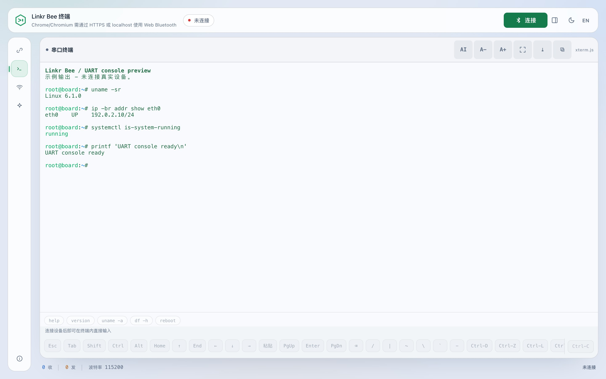

# Linkr Bee 使用指南

[项目介绍](../README.zh-CN.md) | [文档索引](README.zh-CN.md) | [English user guide](USAGE.md)

本指南介绍 Web、Android / iOS 和 HarmonyOS 共用的终端界面。桌面 CLI / TUI 命令见
[Rust 主机终端说明](../tools/linkr-tui/README.md)（英文）。构建、签名与集成细节放在
[开发指南](DEVELOPMENT.zh-CN.md)和各平台文档中。

## 首次连接

1. 刷入对应配件的固件，连接目标的 3.3 V UART：目标 TX 接 Bee RX，目标 RX 接 Bee TX，
   并共地。C3 Super Mini 的 Bee RX 为 GPIO20，Bee TX 为 GPIO21。
2. 打开客户端。Web 端在仓库根目录运行 `tools/serve_web.sh`，再用 Chrome / Chromium
   访问 `http://127.0.0.1:8765/`。
3. 启用配对授权的板型（C3/C5）在新主机首次连接前把 **GPIO1** 接地，点击
   **连接**，接受系统配对提示；配对完成后释放。WROOM 默认关闭物理授权，不需要
   按 GPIO4。已保存的绑定重连时不需要再次短接。
4. 打开设置中的 **串口**，匹配目标的波特率、数据位、校验位、停止位和流控。默认格式为
   `115200,8,n,1,n`。
5. 复位目标，或在终端里按回车，等待目标控制台提示符。

已建立的 BLE 或局域网链路如果意外断开（板子离开范围、重启或断电），终端会自动重拨，
退避间隔为 1、2、4、8、16、30 秒，最多 6 次。状态行显示当前尝试和倒计时，连接按钮变为
**取消重连**；重连成功后保留终端记录并追加 `[reconnect]` 行，不会重放任何输入或命令。
用户主动断开不会自动重连。6 次失败后停止并提示点「重新连接」；TUI 可用
`--no-auto-reconnect` 关闭自动重拨。TUI 按实际连接的设备 ID 重连，不会重新按名称搜索。
拨号过程中也可取消；若系统蓝牙调用尚未返回，客户端会等待其结束并关闭迟到的连接，
不会恢复已取消的会话。
若浏览器报告设备不在范围内，会先尝试监听原设备广播（最多 8 秒）。浏览器不支持或仍
无法发现时停止自动重试，按钮显示「重新选择设备」；请保持 Bee 供电，点击并选择原设备。
重新选择会核对原设备 ID，不会连到同名的另一台 Bee；如需更换，请使用「切换设备」。
此流程不会删除已有配对记录，也不会在后台自动弹出设备选择窗口。

同一时刻只允许一个 BLE 主机连接。若其他客户端正占用连接，先在那里断开。绑定丢失或
绑定列表已满时，参考[蓝牙配对与恢复](BLE_PAIRING.md)。

## 界面导览

*截图使用中文界面和示例 UART 输出，展示断开连接后保留日志的布局，不代表真实硬件会话。*

| 区域 | 用途 |
| --- | --- |
| 顶部栏 | 连接状态、连接 / 断开、设置面板开关、主题与语言 |
| 左侧导航 | 连接、串口、网络、板载、助手与关于页面 |
| 终端 | 目标输出、连接后的直接输入、选择与历史滚动 |
| 终端工具栏 | 助手工作区、字号、全屏、滚动到底部与复制 |
| 附加按键 | Esc、Tab、修饰键、方向、粘贴、回车与 Ctrl 组合 |
| 状态栏 | 收发字节数、波特率与连接状态 |

### 串口设置

- **UART** 修改配件的实际串口格式。除非 CTS / RTS 均已接好且目标使用硬件流控，否则
  保持关闭。
- **回车键** 选择 raw、CR、LF 或 CRLF；按目标约定设置，不要靠本地回显掩盖行尾错误。
- **本地回显** 在本机显示输入；Shell 已经回显时通常应关闭，否则字符可能出现两次。
- **分片大小** 影响发送分块，不是波特率；除非排查传输限制，否则保留默认值。
- **终端字体** 使用主机已经安装的字体；Nerd Font 扩展符号需要本机安装相应字体。

每张设置卡片都可以用标题右侧的箭头折叠，状态会记住。配置完成后关闭面板，把空间
还给终端。串口设置和配件诊断走 BLE 管理通道，不会作为命令输入目标 Shell，也不能
通过纯局域网会话修改。

### 板载面板（Linkr Bee X1.0）

**板载** 页只出现在 Linkr Bee X1.0 配件上。它和串口设置一样通过加密的管理通道
操作板子自身的硬件，这里的命令不会写进目标机的串口。

- **状态灯**：设置单线 RGB 灯，点色块或选自定义颜色后按「应用」，「关闭」熄灭。
  状态行显示板子回报的颜色。
- **隔离干接点（J5）**：闭合 / 断开光耦接点（可当作目标的复位或电源键），
  也可以按设定的毫秒数发一个脉冲。
- **红外遥控与学习**：按地址、命令和重复帧数发送一帧 NEC，并显示接收计数与
  最近解码到的一帧；也可以学习任意遥控器：选槽位 → 点「学习」→ 按一下遥控器
  按键，松手约 60 ms 后自动收尾并写入板子的 NVS，掉电重启仍在。「已保存的信号」
  把每个槽位列为可直接调用的行：点「回放」无需再选槽位即可重发，点「删除」清空，
  点「改名」可以用中文/英文等任意名字标记这一行。波形和名字都保存在板子的 NVS
  里，掉电不丢，换手机或清浏览器缓存也不会丢。超出固件段数上限的长协议会被拒绝，
  不会截断。

其他板型的固件会返回 `ERR ... unsupported`，此时这一页会显示提示并禁用按钮；
没有对应硬件的板子不会出现这个标签页。

没有硬件也可以预览：打开 `/?demo=board`，页面会连上一台模拟的 Linkr Bee X1.0，
自动切到板载页，状态灯、光耦、红外和学习的交互与真机一致；不带参数时行为不变。

### 手机与平板

  

终端始终是主要工作区。触控设备与窄窗口将设置放进抽屉；附加按键行可横向滚动查看更多
按键。先点 Ctrl、Alt 或 Shift，再点下一个键组合发送；再点一次修饰键可取消。

触摸操作与手机自带的选择模式一致：上下拖动查看历史，不会呼出键盘；轻点终端呼出键盘；
长按即可开始选择，手指下的单词会先被选中，并出现两个可拖动的小圆点——拖动圆点即可按字符、
跨行精确调整选区，然后点浮动“复制”按钮或工具栏复制按钮复制。即使 WebView 在长按过程中清空
自己的选区，复制仍返回刚才选中的文字，且复制不会抢走焦点或关闭键盘。复制选区时会保留折行；
剪贴板回退同样不抢焦点。软键盘已经打开时同样可用：
长按照样选词、拖动圆点、复制，上下拖动照样查看历史，键盘不会关闭。复制按钮只复制选区，
没有选区时不写入剪贴板；浏览器 Web 端保留浏览器自带的选择手柄和复制菜单，不绘制这两个圆点。
键盘按钮跟随实际输入法状态（包括用安卓自带隐藏按钮收起的键盘），
再按一次会重新请求显示键盘。安卓端不再发送 `stty rows/cols`，键盘开合只改变本地终端大小，
对端 tty 尺寸保持不变。

助手在窄窗口中位于终端下方，宽度足够时与终端左右排列。系统键盘用于编辑助手问题或
设置时，终端可折叠以保留输入空间；点 **显示终端** 返回 UART 输入。折叠期间继续接收日志。

这些是共享界面的响应式布局。原生键盘与 BLE 行为仍取决于平台；模拟器截图不等于真机
通过，请查看[移动端](../mobile/README.md)和[鸿蒙端](../harmonyos/README.md)的验证范围。

## 输入与显示

- 输入前轻点终端；系统键盘缺少 Esc、Tab、方向键或 Ctrl 组合时，使用附加按键。
- 目标需输出 ANSI 序列才能产生彩色或全屏界面。Web 终端通过 xterm.js 处理 256 色和
  光标控制。
- 浏览器客户端在支持的 Shell 提示符处，于登录后和布局改变时同步行列数。这是 UART 上的
  尽力同步，不是 SSH PTY；Bootloader 和自定义控制台不一定支持 Shell 尺寸命令。原生
  手机 App 在软键盘开合时只改变本地显示，远端 TTY 尺寸保持不变。
- 乱码时先检查串口格式和共地，再考虑字体。
- 有输出但无法输入时，检查目标 RX 是否接到 Bee TX，以及流控是否正确。本地回显不等于
  目标已收到字节。

## 串口助手

在终端工具栏点 **AI**，再打开助手标题栏中的 **设置**。选择接入商，确认端点和协议，
按需填写自己的 API Key 并选择模型。接入商支持时，**获取模型列表** 会查询当前模型 ID；
输入框仍可手动编辑。

支持 OpenAI 兼容、Anthropic 和 Gemini 协议。浏览器直接访问配置的端点，因此端点需要
允许当前页面的 CORS 请求，HTTPS 页面也不能任意访问不安全的 HTTP 地址。额外请求头可在
设置中填写；详细说明见[移动端助手文档](../mobile/README.md#built-in-serial-assistant-pi)。

| 档位 | 串口输入策略 |
| --- | --- |
| 手动 | 每次拟发送的输入都需要审批。 |
| Auto（默认） | 检测到 Shell 提示符时，识别出的低风险查询可直接执行；其他输入需审批。 |
| Full Auto | 常规输入最多可连续自动执行 15 分钟；识别出的破坏性命令和标记为“总是询问”的命令仍需审批。 |

桥接器配置修改另有确认步骤。串口策略由本地规则判断，不采信模型自己的风险评级；它
不是沙箱，脚本、别名与非 Shell 控制台可能有不同行为。应检查拟发送命令和后续输出，
发出字节或看到提示符都不能证明成功。**停止** 会取消待执行的助手工作，但不能撤回已
发送的字节；需要中断目标程序时，使用终端 Ctrl-C。

### 板载 AI 配置

AI 配置在输入框失去焦点时自动保存；底部的小「立即保存」按钮只用于重试，以及
明文 http 端点需要显式确认密钥的情况。通过蓝牙连接时，AI 设置里的「保存到板载」
会把当前配置（地址、模型、协议、token 上限）存进板子的 NVS；换手机或浏览器后可
点「从板载载入」会填回表单并自动应用到本机。只有勾选「包含 API Key 与
附加请求头」时才会把密钥和请求头一起写入：板载数据是明文，任何已配对主机都能
读取，请只在自己的板子上这样做。

AI 页还有一张「板载 AI 提示词」卡片：一段自定义指令存在板子的 NVS 里。读取/
编辑后点「保存到板子」；助手在每轮对话开始时读取一次，所以它跟着板子走，换手机
或换浏览器都生效。点「清除」可删除。

高级选项和导入入口收在模型卡片底部；目标机绑定与存储说明是页面底部的折叠卡片。

### 从 CLIProxyAPI 导入

在 AI 设置中展开 **从 CLIProxyAPI 一键导入**，填写服务地址（默认
`http://127.0.0.1:8317`）和临时管理密钥，点击 **连接并导入**。
Bee 只读 v8 管理 API 的客户端 Key 列表，再用客户端 Key 获取模型；仅有一个 Key
和模型时直接保存，否则选择后点击 **保存导入配置**。导入会替换当前 AI 配置，
失败或取消时保留原配置。模型列表读取成功不代表已验证对话、流式输出或工具调用。

管理密钥不会持久保存，也不会发送给模型；输入框在发起读取后清空。
日常保存的只有客户端 Key、模型地址和模型等常规配置。管理 API 未启用时仍可手动配置。
此入口要求支持 v8 管理 API 及修复后 CORS 的 CLIProxyAPI 版本，不导出上游 OAuth 凭据。
手机访问电脑上的服务需填写电脑的局域网地址；远程管理需按
[上游管理 API 文档](https://help.router-for.me/cn/management/apiv8) 配置访问权限。

### 数据与隐私

- API Key 明文保存在浏览器 / App 本地存储（`linkr-agent-model`），用于向所选接入商
  发请求，不交给 Bee 配件或 Linkr 中转服务。清除配置或站点数据即可删除，公共主机上
  尽量不要保存凭据。
- 问题上下文可能包含串口日志与设备笔记。脱敏只能尽力处理，发给模型服务前仍应检查
  敏感输出。
- 对话和设备笔记保留在客户端本机，是历史证据，不代表目标的当前状态。
- 模型推理由所选服务完成；可选择本地 Ollama 端点，但手机 App 本身不内置离线语言模型。

## 局域网与日志

1. 保持 BLE 连接，在 **网络** 页面把配件接入 2.4 GHz WiFi。
2. 获取配件地址和访问令牌。Web 客户端通过加密 BLE 自动读取令牌；其他客户端可用管理
   查询 `@s?`。
3. 在连接设置中切换 **局域网**，填写地址与令牌。

局域网通过 WebSocket 承载 UART 数据，配置仍走 BLE。令牌只控制访问，不加密 `ws://`
流量，应在可信网络中使用。

**保存日志** 在主机端导出收到的串口数据；WebDAV 则由配件在配置 WiFi 和上传目标后自行
上传 UART 日志。当前固件仅接受匿名 **HTTP** 地址，不支持 HTTPS 或 Basic Auth，应把
端点放在可信网络内。部分构建会为适配内存预算而关闭 WebDAV，以对应构建的配置为准。

日常排查先看 [README 常见问题](../README.zh-CN.md#常见问题)。固件命令、计数器与
持久化细节见[开发指南](DEVELOPMENT.zh-CN.md#控制命令参考)。
